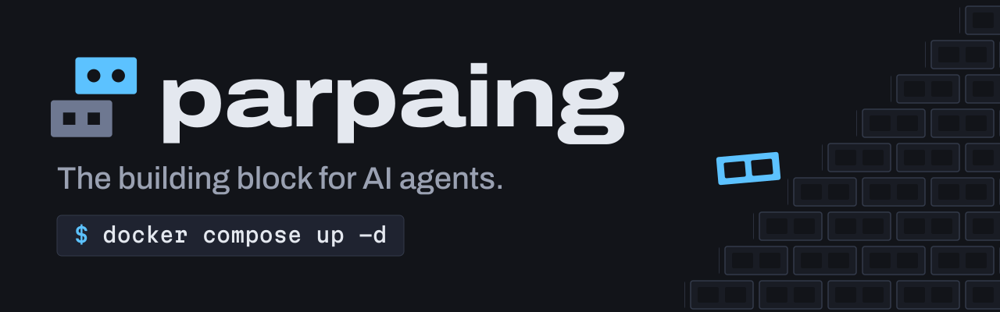

<p align="center"></p>

# parpaing

**parpaing** (French for *cinder block*): self-hosted sandboxes for AI agents, driven by an HTTP API. Your own machine, only Docker.

Website: <https://parpaing.dev>

> **Early stage.** parpaing is not stable yet: the API will change until 1.0.0. The changes will land over the coming weeks, to reach 1.0.0 quickly. See the [roadmap](ROADMAP.md).

## Quick start

```sh
curl -O https://raw.githubusercontent.com/enixCode/parpaing/main/compose.yml
docker compose up -d
```

Human digest API demo at <http://127.0.0.1:8090>. The API answers on the same port.

The page creates sandboxes and runs commands in them; each action shows the request, the answer and the matching `curl` command.

The API reference is at <http://127.0.0.1:8090/docs>.

Set `PARPAING_API_KEY` to require `Authorization: Bearer <key>` on every call. Without it, anyone who reaches the port can use the API.

## API

| Feature | Endpoint | What it does | Status |
|---|---|---|---|
| Sandboxes (CRUD) | `POST /sandboxes`<br>`GET /sandboxes`<br>`GET /sandboxes/:id`<br>`DELETE /sandboxes/:id` | Create, list, read, remove | 🟢 Done |
| Run a command | `POST /sandboxes/:id/exec` | Live output, then the exit code | 🟢 Done |
| Info | `GET /info` | Version, engines, capacity, sandbox count | 🟢 Done |
| OpenAPI | `GET /openapi.json` | The API description, generated from the code | 🟢 Done |
| Archives | `GET /sandboxes/:id/archive?path=`<br>`PUT /sandboxes/:id/archive?path=` | Save a folder, restore it | ⚪ Planned |
| API key | `Authorization: Bearer <key>` | Optional, with `PARPAING_API_KEY` | 🟢 Done |
| Limits | `POST /sandboxes` + `memory`, `cpus`, `processes`, `disk` | Caps per sandbox | ⚪ Planned |
| Engine | `POST /sandboxes` + `runtime` | `runc` or `runsc` (gVisor) | ⚪ Planned |

🟢 Done: works today, can still change before 1.0.0. 🟡 In progress: being built. ⚪ Planned: not started.

See the details in [ROADMAP.md](ROADMAP.md).

## Isolation

| Engine | What it is | For | Status |
|---|---|---|---|
| runc | Docker's default: the sandbox shares the host's kernel | Dev, pre-prod | 🟢 Done |
| runsc (gVisor) | A kernel in Go between the sandbox and the host, on any Linux server, no KVM needed | Prod | ⚪ Planned |
| Kata Containers | A small virtual machine per sandbox, needs KVM | To plan | ⚪ Planned |

Which engine supports what: [docs/runtimes.md](docs/runtimes.md).

## How it works

- **A sandbox is a Docker container** labelled `parpaing.sandbox`. Parpaing never touches other containers.
- **Always on**: the container runs `sleep infinity` and waits for commands.
- **No state in Parpaing**: Docker keeps everything.
- **One port**: the `gateway` container (nginx) serves the web page and the brand kit, and relays the API. The `parpaing` container also works alone, without the page.

## Services


## Contributing

- **Issues are welcome**: bugs, questions, ideas. [Open one](https://github.com/enixCode/parpaing/issues).
- **No pull requests for now.**

## License

[AGPL-3.0](LICENSE)
