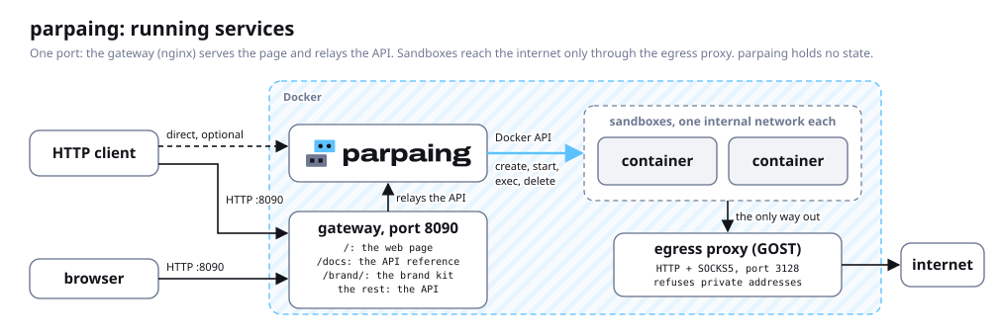

<p align="center"></p>

# parpaing

**parpaing** (French for *cinder block*): self-hosted sandboxes for AI agents, driven by an HTTP API. Your own machine, only Docker.

Website: <https://parpaing.dev>

> **Stable since 1.0.0.** The API follows semantic versioning: no breaking change before 2.0.0, only new routes and new optional fields. See the [roadmap](ROADMAP.md).

## Quick start

```sh
curl -O https://raw.githubusercontent.com/enixCode/parpaing/main/compose.yml
docker compose up -d
```

Human digest API demo at <http://127.0.0.1:8090>. The API answers on the same port.

The page creates sandboxes and runs commands in them; each action shows the request, the answer and the matching `curl` command.

The API reference is at <http://127.0.0.1:8090/docs>.

Set `PARPAING_API_KEY` to require `Authorization: Bearer <key>` on every call. Without it, anyone who reaches the port can use the API.

## API

| Feature | Endpoint | What it does | Status |
|---|---|---|---|
| Sandboxes (CRUD) | `POST /sandboxes`<br>`GET /sandboxes`<br>`GET /sandboxes/:id`<br>`DELETE /sandboxes/:id` | Create, list, read, remove | 🟢 Done |
| Run a command | `POST /sandboxes/:id/exec` | The exit code, stdout and stderr in one answer; `stream: true` for live output | 🟢 Done |
| Info | `GET /info` | Version, engines, capacity, sandbox count | 🟢 Done |
| OpenAPI | `GET /openapi.json` | The API description, generated from the code | 🟢 Done |
| Archives | `GET /sandboxes/:id/archive?path=`<br>`PUT /sandboxes/:id/archive?path=` | Download a folder as a tar, upload one back, streamed (tested with 3 GB). The image needs `tar` | 🟢 Done |
| API key | `Authorization: Bearer <key>` | Optional, with `PARPAING_API_KEY` | 🟢 Done |
| Limits | `POST /sandboxes` + `memory`, `cpus`, `processes`, `disk`, `wait` | Ceilings per sandbox, readable inside with `env`. Disk: enforced on gVisor only | 🟢 Done |
| Network | `POST /sandboxes` + `network` | `internet` through the egress proxy (HTTP, HTTPS, SOCKS5, ssh), or `none` | 🟢 Done |
| Engine | `POST /sandboxes` + `runtime` | `runc` or `runsc` (gVisor), `PARPAING_RUNTIME` for the default | 🟢 Done |

See the details in [ROADMAP.md](ROADMAP.md).

## SDK

TypeScript, no dependency (Node 18+, Deno, Bun, browsers), in [sdk/](sdk/). Not on npm yet.

```ts
import { Parpaing } from "parpaing";

const parpaing = new Parpaing({ url: "http://127.0.0.1:8090" });
const { id } = await parpaing.create({ image: "node:24" });
await parpaing.exec(id, ["node", "-v"]); // { exitCode, stdout, stderr, truncated }
await parpaing.exec(id, ["npm", "test"], { onOutput: (data) => process.stdout.write(data) }); // live, then { exitCode }
await parpaing.delete(id);
```

## Isolation

| Engine | What it is | For | Status |
|---|---|---|---|
| runc | Docker's default: the sandbox shares the host's kernel | Dev, pre-prod | 🟢 Done |
| runsc (gVisor) | A kernel in Go between the sandbox and the host, on any Linux server, no KVM needed. Enforces the disk limit | Prod | 🟢 Done |
| Kata Containers | A small virtual machine per sandbox, needs KVM | To plan | ⚪ Planned |

To use runsc, install gVisor once per machine; it registers itself in Docker:

```sh
URL=https://storage.googleapis.com/gvisor/releases/release/latest/$(uname -m)
wget $URL/gvisor.tar.zstd $URL/gvisor.tar.zstd.sha512 && sha512sum -c gvisor.tar.zstd.sha512
sudo tar --zstd -xf gvisor.tar.zstd -C /usr/local/bin
sudo runsc install && sudo systemctl restart docker
```

Then ask `"runtime": "runsc"` per sandbox, or set `PARPAING_RUNTIME=runsc` for every sandbox.

Which engine supports what: [docs/runtimes.md](docs/runtimes.md).

## Next: the sandbox daemon

A small program inside each sandbox, brought by parpaing, not by the image. It is the base of:

- **Sessions**: a shell that keeps its folder and variables, background commands.
- **Command id**: each command gets an id.
- **Stop a command**: by its id, with everything it started.
- **File API**: read, write and list files with WebDAV (Explorer, Finder, rclone).
- **Interactive terminal**: live keyboard, resizable.

Planned for 1.x, see the [roadmap](ROADMAP.md).

## How it works

- **A sandbox is a Docker container** labelled `parpaing.sandbox`. Parpaing never touches other containers.
- **Always on**: the container runs `sleep infinity` and waits for commands. It starts again with Docker, with its files but not its processes.
- **Its own network**: each sandbox sits alone in an internal network. Its only way out is the egress proxy (GOST), which refuses the host, the local network, cloud metadata and other sandboxes. Programs find it in `HTTP_PROXY`, `HTTPS_PROXY` and `ALL_PROXY`; ssh with `-o ProxyCommand='nc -X connect -x $PARPAING_PROXY %h %p'`. Programs that ignore proxies (`psql`) need `proxychains` or an ssh tunnel.
- **No state in Parpaing**: Docker keeps everything.
- **One port**: the `gateway` container (nginx) serves the web page and the brand kit, and relays the API. The `parpaing` container also works without the page; sandboxes with internet need the `egress` container.

## Services



## Contributing

- **Issues are welcome**: bugs, questions, ideas. [Open one](https://github.com/enixCode/parpaing/issues).
- **No pull requests for now.**

## License

[AGPL-3.0](LICENSE)
