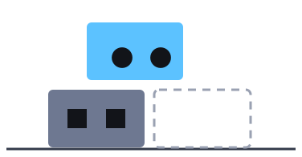

# parpaing brand guidelines

The parpaing logo kit and how to use it. Every file in this folder is a standalone SVG (text converted to paths), plus one PNG.

  <picture>
    <source media="(prefers-color-scheme: dark)" srcset="logo-wordmark-dark.svg">
    
  </picture>

## Files

| File | Use |
|---|---|
| [`logo.svg`](logo.svg) | The symbol: avatar, app icon, anywhere the name is already written nearby |
| [`favicon.svg`](favicon.svg) | Browser tab icon (square frame) |
| [`logo-wordmark-dark.svg`](logo-wordmark-dark.svg) | Symbol and name, on dark backgrounds |
| [`logo-wordmark-light.svg`](logo-wordmark-light.svg) | Symbol and name, on light backgrounds |
| [`banner.svg`](banner.svg) | README header, 1280 x 400 |
| [`social.svg`](social.svg), [`social.png`](social.png) | Link preview card, 1280 x 640 (GitHub needs the PNG) |

## Logo

  

- Two offset blocks, a light blue one on top of a steel one. The two round holes of the top block are its eyes.
- Use the wordmark (symbol and name) by default. Use the symbol alone only where the name already appears.

## Mascot

  
  
  
  
  

- Aglo is the parpaing mascot: the logo's exact shapes, drawn as a character.
- The animated files show a still pose when reduced motion is on.
- Every Aglo file has the same height and the same ground line: shown at the same height, Aglo keeps the same size.

| File | Use for |
|---|---|
| [`aglo.svg`](aglo/aglo.svg) | Default illustration: docs, about pages, anywhere Aglo just appears |
| [`aglo-idle.svg`](aglo/aglo-idle.svg) | Waiting: idle screens (animated: floats gently, blinks now and then) |
| [`aglo-working.svg`](aglo/aglo-working.svg) | Something is running: a command, a sandbox starting (animated, loops) |
| [`aglo-error.svg`](aglo/aglo-error.svg) | A request failed (animated: the top block falls, then keeps trying to stand up and rocks back) |
| [`aglo-empty.svg`](aglo/aglo-empty.svg) | Nothing yet: empty lists, no sandbox created (animated: floats, looks at the empty slot, then at you; the dotted outline moves) |

## Colors

The logo always uses these colors, on an anthracite or a light background.

| Name | Hex | Role |
|---|---|---|
| Plan Blue | `#5cc2ff` | Top block, accents, the `$` of commands |
| Steel | `#6e7891` | Bottom block |
| Steel Shade | `#5c657b` | Secondary text on light backgrounds, finished steps in the web page |
| Anthracite | `#121419` | Background, eyes and holes, name on light backgrounds |
| Chalk | `#e4e8ef` | Name and text on dark backgrounds |
| Muted | `#9aa1b2` | Secondary text |
| Wall | `#191c24` | Background blocks of the banner |
| Panel | `#1f2330` | Command box |
| Line | `#333a4a` | Borders and outlines |

## Typography

All three fonts are free on Google Fonts (SIL Open Font License).

| Font | Use |
|---|---|
| [Archivo](https://fonts.google.com/specimen/Archivo) ExtraBold 800, width 125 % | The name `parpaing` |
| Archivo Medium 500, width 100 % | Text and slogans |
| [Martian Mono](https://fonts.google.com/specimen/Martian+Mono) Medium 500 | Commands and code |

## Name

- Always lowercase: `parpaing`, in the wordmark and in text.
- French for *cinder block*, pronounced roughly "par-pan".

## Size and clear space

- Minimum size: 16 px for the symbol, 24 px tall for the wordmark.
- Keep free space around the logo at least as tall as one block (about half the symbol's height).

## Don'ts

- Don't flip, tilt, stretch or squeeze the logo.
- Don't recolor it, add gradients, shadows or outlines.
- Don't crop it or rearrange the blocks.
- Don't change the spacing or the order of the symbol and the name.
- Don't set the name in another font.
- Don't place the logo on a busy background or a photo without a solid area behind it.

## Trademark

The code is under the [GNU AGPL-3.0](../../LICENSE). The license covers the code, not the parpaing name or logo: using them beyond describing where a work comes from needs permission.
